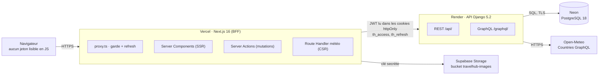

# TravelHub TP2 — Cahier des charges, feuille de route et prompts

17 novembre 2026. Copie en Markdown du document de planification de l'équipe, pour que l'assistant de code puisse la lire depuis le dépôt.

## 1. Synthèse : par où commencer

Commencez par quatre petites corrections du back-end Django, pas par l'interface : un champ image, le rôle de l'utilisateur sur un voyage, le CORS pour Vercel et le port Gunicorn. Créez ensuite l'application Next.js dans un dossier `frontend/` du même dépôt. Branchez l'authentification par cookies httpOnly avant toute page métier. Déployez une première version dès la fin de la première semaine, pour régler tôt les variables d'environnement, ALLOWED\_HOSTS et les cookies.

### 1.1 État du back-end TP1 (tag v1.0)

| Élément | Ce qui existe | Ce qu'il faut pour le TP2 |
| --- | --- | --- |
| API REST | 18 chemins sous /api/ (32 opérations) : auth (register, token, refresh, logout, me), voyages (CRUD, stats, clone, participants), destinations, activités, `weather`, `country`, `overview` | Rien pour le CRUD des voyages, il est complet |
| API GraphQL | `/graphql/` : 6 queries (`me`, `myTrips`, `myTripsCount`, `trip`, `destination`, `destinationOverview`) et 12 mutations, dont create/update/delete pour Destination et Activity | Rien, la query et la mutation demandées existent déjà |
| Authentification | SimpleJWT, en-tête `Authorization: Bearer` seulement. Accès 15 min, refresh 1 jour avec rotation et liste noire | Le front-end ne doit jamais lancer deux rafraîchissements du jeton en même temps |
| Format d'erreur | REST : `{"error": {"code", "message", "details"}}`. GraphQL : `errors[].extensions.code` avec HTTP 200 | Une fonction de traduction des erreurs côté Next.js |
| Image | Aucun champ image ou URL | Ajouter `cover_image_url` sur Trip (migration) |
| Rôle de l'utilisateur | Non exposé dans les réponses | Ajouter `my_role` (REST) et `myRole` (GraphQL) |
| CORS | Liste d'origines lue dans l'environnement, sans regex, sans credentials | Mettre le domaine Vercel dans CORS\_ALLOWED\_ORIGINS, comme l'exige l'énoncé (regex des previews facultative) |
| Déploiement | Dockerfile non root, Gunicorn, settings de prod, `check --deploy` sans avertissement | `PORT` ignoré par Gunicorn, aucun fichier Render ou Railway |
| Tests | 724 tests pytest, couverture 98 %, CI GitHub Actions | Garder la CI verte après chaque changement |
| Dépôt GitHub | Public, un seul auteur dans l'historique, le 2e membre n'est pas collaborateur, `master` non protégé, PR Dependabot #5 ouverte | À corriger le premier jour, la note de collaboration en dépend |

### 1.2 Les dix premières actions

1. Configurez `git config user.name` et `user.email` avec votre propre identité.
2. Protégez `master` : pull request obligatoire, une relecture, la CI « Lint et tests » verte.
3. Enregistrez ce plan dans le dépôt (docs/plan-tp2.md) pour que l'assistant puisse le lire. Fusionnez ou fermez la PR Dependabot #5, puis lancez `git fetch --prune`.
4. Installez Node.js 26 LTS (26.13 ou plus). Lancez aussi l'API en local (README : venv ou docker compose up --build, puis seed\_demo) et suivez les chapitres 1 à 12 du cours officiel Learn Next.js (nextjs.org/learn), environ trois heures.
5. Créez les comptes gratuits : Vercel, Supabase, Neon (PostgreSQL) et Render (API Django).
6. Branche `backend/tp2-ajustements` avec le prompt P1 (section 7).
7. Branche `frontend/socle` avec le prompt P2. L'application est créée dans `frontend/`.
8. Couche d'accès aux données (P3), puis mise en page, navigation et états de chargement (P5).
9. Authentification et routes protégées (P4), qui branche la session sur la mise en page de P5.
10. Fin de la première semaine : premier déploiement Vercel + Render + Neon (P6), même avec une seule page.

Question ouverte : la date de remise n'est pas dans l'énoncé fourni. Le plan compte donc en jours de travail (J1 à J14).

## 2. Cahier des charges

Le TP2 livre l'interface Web de TravelHub en Next.js, branchée sur le back-end Django du TP1 (tag v1.0), puis met les deux en ligne. Le back-end et PostgreSQL restent la source de vérité. Supabase ne sert qu'aux images.

### 2.1 Contexte

TravelHub est une plateforme de planification de voyages. Le TP1 a livré une API REST (DRF), une API GraphQL (Graphene), l'authentification JWT et deux intégrations externes : Open-Meteo pour la météo et Countries GraphQL pour les pays. Le TP2 du cours INF37407 ajoute le front-end, l'intégration Supabase Storage, les tests Vitest et le déploiement public. L'équipe compte deux membres qui doivent tous deux contribuer au dépôt.

### 2.2 Objectifs mesurables

| # | Objectif | Critère de réussite |
| --- | --- | --- |
| O1 | Interface Web moderne et adaptative | Toutes les pages restent utilisables de 360 px à 1440 px de large |
| O2 | CRUD des voyages par l'API REST | Créer, lire, modifier et supprimer un voyage depuis l'interface, données persistées dans PostgreSQL |
| O3 | Destinations et activités par GraphQL | Au moins une query et une mutation GraphQL utilisées dans l'interface |
| O4 | Informations enrichies | Météo Open-Meteo et fiche pays visibles sur la page d'une destination, servies par l'API TravelHub |
| O5 | Authentification et routes protégées | Un visiteur non connecté est redirigé vers /login ; un jeton expiré est rafraîchi ou mène à une reconnexion propre |
| O6 | Images Supabase | Ajout et affichage d'une image de voyage ou de destination, envoi par une route serveur Next.js |
| O7 | Qualité | Au moins 5 tests Vitest + React Testing Library verts avec npm test, npm run build sans erreur |
| O8 | Déploiement | Front-end sur Vercel et back-end public qui communiquent (CORS et ALLOWED\_HOSTS adaptés au domaine Vercel) |
| O9 | Livrables | Rapport LaTeX et vidéo OBS montrant la version déployée |

### 2.3 Périmètre

| Inclus (obligatoire) | Hors périmètre | Bonus valorisé |
| --- | --- | --- |
| Connexion, inscription, déconnexion | Paiement, réservation réelle | Suspense et streaming |
| Tableau de bord après connexion | Application mobile native | Cache et revalidation ciblés |
| CRUD voyages (REST) | Temps réel (WebSocket) | Tests E2E Playwright |
| CRUD destinations et activités (GraphQL + REST) | Plusieurs langues | Mises à jour optimistes |
| Météo et pays d'une destination | Appels directs du navigateur à Open-Meteo ou Countries | Mode sombre |
| Image d'un voyage ou d'une destination (Supabase) | Authentification Supabase (l'auth reste Django) | Gestion des participants dans l'interface |
| États Loading, Error, Empty |  | Suivi d'erreurs et monitoring |
| Tests, build, déploiement, rapport, vidéo |  |  |

### 2.4 Acteurs

- **Visiteur** : voit la page d'accueil, se connecte ou crée un compte. Toute autre page le renvoie vers /login.
- **Utilisateur connecté** : voit son tableau de bord, ses voyages et ceux où il est participant.
- **Rôles sur un voyage** (repris du TP1) : propriétaire, éditeur, lecteur. L'interface masque les boutons de modification à un lecteur, mais c'est Django qui tranche.
- **Systèmes** : Next.js sur Vercel, API Django sur un hébergeur public, PostgreSQL, Supabase Storage. Open-Meteo et Countries GraphQL ne sont appelés que par Django.

### 2.5 Contraintes

- **Technologies imposées** : VS Code, TypeScript, HTML, CSS, React, Next.js App Router, Tailwind CSS, shadcn/ui, Fetch API, Supabase, Vercel, Git et GitHub. Les versions retenues sont à la section 5.
- **Création du projet** en ligne de commande (create-next-app, puis shadcn CLI).
- **Secrets** : aucun dans le code. Le fichier .env reste hors du dépôt et hors de l'archive remise ; un .env.example liste les variables sans valeurs.
- **Jeton d'authentification** : pas de localStorage, car les Server Components ne peuvent pas le lire. Choix justifié dans le rapport.
- **Clé Supabase secrète** : lue uniquement côté serveur, jamais préfixée NEXT\_PUBLIC\_.
- **Commandes attendues** : npm test lance Vitest, npm run build réussit avant chaque déploiement.
- **Collaboration** : commits réguliers et explicites des deux membres, branches de fonctionnalité, quelques pull requests relues.
- **Rapport** : tableau page par page (type de composant, stratégie de rendu, justification) et brève description des corrections apportées au back-end.

## 3. Exigences fonctionnelles

Chaque section 3.x de l'énoncé devient une exigence vérifiable. La colonne « Terminé quand » sert de grille d'auto-évaluation avant la remise.

| Réf. | Énoncé | Mise en œuvre retenue | Terminé quand |
| --- | --- | --- | --- |
| EF-01 | 3.1 Application Next.js | `create-next-app` dans `frontend/`, dossier `src/`, types dans `src/types/`, configuration par variables d'environnement | `npm run build` passe ; Trip, Destination, Activity, User et les réponses paginées ont un type ; `.env.example` existe |
| EF-02 | 3.2 Interface en composants | Composants shadcn/ui dans `components/ui/`, composants métier par domaine (`trips/`, `destinations/`, `activities/`), props typées, hooks React | Aucun bloc d'interface copié entre deux pages ; affichage correct à 360, 768 et 1280 px |
| EF-03 | 3.3 Routage et navigation | App Router, groupes `(auth)` et `(app)`, routes dynamiques `[tripId]` et `[destinationId]`, layouts partagés, fil d'Ariane | On va de la liste des voyages au voyage, puis à la destination et à ses activités par des liens, sans saisir d'URL |
| EF-04 | 3.4 Tableau de bord | Page `/dashboard` : voyage en cours, prochains voyages, compteurs (voyages, voyages à venir, budget, coût total et budget restant du prochain voyage), boutons d'accès rapide | Les chiffres correspondent à ceux de l'API Django pour le compte `alice` |
| EF-05 | 3.5 Gestion des voyages | Liste avec filtre de statut, recherche et pagination ; détail ; formulaires de création et de modification ; suppression avec confirmation | Chaque opération est visible dans PostgreSQL ; une erreur 400 s'affiche sous le bon champ |
| EF-06 | 3.6 Destinations et activités | Depuis un voyage : itinéraire ordonné des destinations, chacune avec ses activités ; formulaires d'ajout, de modification et de suppression | L'interface se met à jour sans recharger la page ; la hiérarchie voyage → destination → activité est visible |
| EF-07 | 3.7 Informations enrichies | Page d'une destination : fiche pays (drapeau, capitale, monnaie, langues) et météo (actuelle et prévisions du séjour) | L'onglet Réseau du navigateur ne montre aucun appel direct à Open-Meteo ou Countries |
| EF-08 | 3.8 API REST | Lecture, création, modification et suppression des voyages par `/api/trips/` ; profil et authentification par `/api/auth/` | Les quatre verbes HTTP sont utilisés ; chaque code d'erreur a un message français clair |
| EF-09 | 3.9 API GraphQL | Query `destinationOverview` ou `destination` ; mutations `createDestination`, `updateDestination`, `deleteDestination`, `createActivity`, `updateActivity`, `deleteActivity`, avec variables | Au moins une query et une mutation passent par `/graphql/` ; `errors[]` est traité |
| EF-10 | 3.10 Server et Client Components | Pages et layouts en Server Components ; `"use client"` seulement sur les feuilles interactives (formulaires, dialogues, filtres, météo, envoi d'image) | Chaque fichier `"use client"` a une raison écrite dans le rapport |
| EF-11 | 3.11 Rendu et données | Statique pour l'accueil, SSR pour les pages connectées, CSR pour la météo, hybride avec Suspense ; `revalidatePath` après chaque mutation | Le tableau page par page du rapport est rempli et cohérent avec le code |
| EF-12 | 3.12 États de l'interface | `loading.tsx` et squelettes dans `Suspense`, `error.tsx` avec bouton Réessayer, `not-found.tsx`, composant `EmptyState` | Chaque liste montre ses trois états : chargement, vide, erreur |
| EF-13 | 3.13 Authentification | Connexion, inscription, déconnexion ; jetons en cookies httpOnly ; `proxy.ts` redirige vers `/login` (proxy.ts est le middleware Next.js, renommé proxy en version 16) ; vérification serveur avant chaque accès aux données | Un cookie supprimé, invalide ou expiré mène à un rafraîchissement ou à une reconnexion propre, jamais à une page cassée |
| EF-14 | 3.14 Validation et erreurs | Schémas Zod qui reprennent les règles Django ; erreurs serveur ramenées sur les champs ; messages pour 400, 401, 403, 404, 429, 5xx et panne réseau | Une date de fin avant la date de début est bloquée avant l'envoi, et Django la refuse aussi |
| EF-15 | 3.15 Supabase | Bucket Supabase Storage ; envoi par Server Action avec la clé secrète côté serveur ; URL publique enregistrée dans Django (`cover_image_url`) | L'image reste après rechargement ; la clé n'apparaît pas dans `.next/static` |
| EF-16 | 3.16 Tests et qualité | Vitest + React Testing Library + MSW ; au moins cinq tests (rendu, interaction, API simulée, erreur, validation) | `npm test` est vert en local et dans la CI ; les deux membres ont des commits et des PR fusionnées |
| EF-17 | 3.17 Déploiement | Front-end sur Vercel, API sur Render (Docker), base sur Neon ; variables configurées sur chaque plateforme ; CORS adapté | Le parcours complet marche sur l'URL Vercel publique, avec `npm run build` vert avant le déploiement |

La section 4 de l'énoncé (structure du projet) est traitée à la section 5 ci-dessous, et la section 5 (livrables) à la section 8.

## 4. Exigences non fonctionnelles full-stack

L'énoncé impose la sécurité, les variables d'environnement, le build et le déploiement. Le reste (conteneurs, monitoring, sauvegardes) est recommandé ou en bonus : faites-le seulement quand les exigences de la section 3 sont terminées.

| Domaine | Exigence | Mise en œuvre | Niveau |
| --- | --- | --- | --- |
| Front-end | Typage strict, composants réutilisables, responsive, accessible au clavier | `strict: true` dans tsconfig, shadcn/ui (basé sur Radix), libellés sur tous les champs, contraste AA | Exigé |
| Back-end / API | Django reste responsable des données métier et des règles | Le front-end ne contourne jamais Django ; les corrections du TP1 sont décrites dans le rapport | Exigé |
| Base de données | PostgreSQL accessible publiquement par l'API seulement | Neon Free, PostgreSQL 18, `?sslmode=require` dans `DATABASE_URL` | Exigé |
| Serveurs | API publique et stable pendant la correction | Render Free (runtime Docker, Dockerfile existant), Gunicorn qui lit `PORT`, contrôle de santé sur `/health/` | Exigé |
| Réseau | HTTPS partout ; le navigateur ne parle qu'à Vercel | Navigateur → Next.js (Vercel) → Django (Render) → Neon. CORS réglé sur le domaine Vercel, comme l'exige l'énoncé ; il ne sert qu'en défense en profondeur, car Django est appelé de serveur à serveur | Exigé |
| Cloud | Architecture hybride Next.js + Django + BaaS | Vercel (front-end), Render (API), Neon (données), Supabase Storage (images) | Exigé |
| Secrets | Aucun secret dans le code ni dans le navigateur | `.env.local` ignoré par Git, `.env.example` sans valeurs, paquet `server-only`, aucune clé secrète préfixée `NEXT_PUBLIC_` | Exigé |
| Sécurité | Jetons hors de portée de JavaScript, entrées validées deux fois | Cookies `httpOnly`, `Secure`, `SameSite=Lax` ; Zod côté serveur dans chaque Server Action ; type et taille des images vérifiés ; en-têtes de sécurité dans `next.config.ts` | Exigé |
| CI/CD | Lint, types, tests et build à chaque PR | Nouveau job GitHub Actions `frontend` ; previews Vercel par PR ; déploiement automatique de `master` sur Vercel et Render | Recommandé |
| Conteneurs | Image reproductible de l'API | Dockerfile du TP1 réutilisé par Render. Une image `frontend` avec `output: "standalone"` est possible | API : recommandé ; front-end : bonus |
| CDN | Fichiers statiques et images servis au plus près | Réseau Edge de Vercel pour `_next/static` et `next/image` ; URL publiques Supabase Storage | Recommandé |
| Monitoring et journaux | Savoir pourquoi une requête a échoué | Journaux Vercel et Render ; Next.js envoie un `X-Request-ID` que Django journalise déjà ; vérification manuelle de `/health/` avant la démo, sans sonde permanente (elle empêcherait Neon de s'endormir et épuiserait son quota gratuit) | Recommandé |
| Sauvegardes et reprise | Pouvoir restaurer la base et revenir à une version saine | `scripts/backup.ps1` contre Neon (`PGSSLMODE=require`), restauration Neon (6 heures d'historique sur le plan Free), retour arrière en un clic sur Vercel et Render, Git comme sauvegarde du code | Recommandé |
| Performance | Page connectée utilisable en moins de 3 s une fois l'API réveillée | Rendu serveur, streaming avec `Suspense`, `next/image`, pas de waterfall de requêtes | Recommandé |
| Maintenabilité | Code lisible et facile à expliquer pendant la démonstration | ESLint, TypeScript sans `any`, PR relues, conventions de nommage (section 5) | Exigé |

## 5. Architecture et décisions techniques

Le navigateur ne parle qu'à Next.js. Next.js joue le rôle de BFF (backend for frontend) : il garde les jetons dans des cookies httpOnly et appelle Django de serveur à serveur. Django reste le seul à appeler Open-Meteo, Countries GraphQL et PostgreSQL.

### 5.1 Vue d'ensemble



Chaque flèche va de l'appelant vers l'appelé, toujours en HTTPS. Django vérifie le JWT, les permissions et la validation.

Le navigateur n'appelle que Vercel. Next.js appelle Django avec le JWT lu dans les cookies, et Supabase avec la clé secrète. Seul Django appelle Neon, Open-Meteo et Countries.

### 5.2 Versions retenues (vérifiées le 17 novembre 2026)

| Outil | Version | Pourquoi |
| --- | --- | --- |
| Node.js | 26 LTS (26.13 ou plus), `engines.node: "26.x"` | Version par défaut de Vercel depuis le 29 octobre 2026. Vitest 5, jsdom 31 et MSW 3 exigent Node 22 ou plus ; Node 20 n'est plus supporté |
| Next.js | 16.4.x, dernier correctif | Version stable actuelle. Vercel bloque les versions vulnérables, gardez le dernier correctif |
| React | 19.3 | Installé par create-next-app |
| TypeScript | ^5 (5.9.3) | Installé par create-next-app. Évitez la 7.0, sans API de programmation avant la 7.1 |
| Tailwind CSS | 4.3 | Configuration dans le CSS (`@import "tailwindcss"`, `@theme`) |
| shadcn/ui | CLI `shadcn@latest` (4.x), variante Radix | Composants copiés dans le projet, toasts avec Sonner |
| Zod / React Hook Form | 4.x / 7.x avec `@hookform/resolvers` 7.x | Même schéma pour le client et la Server Action |
| Supabase JS | `@supabase/supabase-js` 2.x | Envoi des images côté serveur avec la clé `sb_secret_…` |
| Tests | Vitest 5.1, React Testing Library 16, user-event 14, jest-dom 7, MSW 3, jsdom 31 | Pile décrite par le guide Vitest de Next.js, plus MSW pour simuler l'API |
| Playwright (facultatif) | 1.65 | Seul moyen de tester les Server Components asynchrones |
| Back-end | Django 5.2.19 LTS, DRF 3.18.3, SimpleJWT 5.5.1, Graphene-Django 3.2.3, Gunicorn 27, PostgreSQL 18 | Stack du TP1. Le 22 novembre 2026, nous avons essayé Django 6.1 (PR Dependabot #9), puis nous sommes revenus à 5.2 LTS. C'est la seule version que SimpleJWT, Graphene-Django, django-cors-headers et drf-spectacular déclarent toutes, et elle est suivie jusqu'en avril 2028. Django 6.1 n'est pas une LTS. Dependabot ignore donc les versions majeures de Django |

### 5.3 Décisions clés

| Sujet | Choix | Pourquoi | Alternative écartée |
| --- | --- | --- | --- |
| Dépôt | Dossier `frontend/` dans le dépôt TravelHub existant | Une seule CI, des PR qui touchent les deux côtés, un dépôt public sur un compte personnel (accepté par Vercel Hobby) | Deuxième dépôt : deux CI et deux README à tenir |
| Cache Components | `--no-cache-components` à la création | Activé par défaut depuis Next.js 16.4 : chaque lecture de cookie doit alors être sous `Suspense`. Le modèle classique colle mieux au vocabulaire SSR, CSR et hybride du cours | Le garder : possible en bonus, mais plus de pièges |
| Composants UI | `shadcn init -b radix`, toasts Sonner | La variante Radix reste supportée et la plus documentée | Base UI, défaut depuis juillet 2026 |
| Jeton | Cookies httpOnly posés par des Server Actions | JavaScript ne peut pas lire le jeton (protection XSS) ; les Server Components lisent les cookies, pas le `localStorage` | `localStorage` + Bearer depuis le navigateur ; cookies de session Django (tiers entre `vercel.app` et `onrender.com`) |
| Routes protégées | `src/proxy.ts` (nouveau nom de `middleware.ts` depuis Next.js 16) + `verifySession()` côté serveur | Le proxy redirige vite ; la vérification serveur reste la vraie barrière | Proxy seul : contournable |
| Formulaires | React Hook Form + Zod, puis Server Action qui revalide avec le même schéma | Retour immédiat à l'utilisateur, test de validation simple, guide officiel shadcn | `useActionState` seul, sans validation avant l'envoi |
| Accès aux données | `fetch` natif dans `src/lib/api/` ; GraphQL par POST avec variables | L'énoncé impose la Fetch API ; un seul endroit pour l'URL, le jeton et les erreurs | Axios, Apollo Client |
| Types | Types écrits à la main d'après les serializers | Montre le typage demandé ; contrôle possible avec `openapi-typescript` sur `/api/schema/` | Tout générer automatiquement |
| Images | Bucket public `travelhub-images`, chemin `trips/{id}/{uuid}.webp`, URL dans `Trip.cover_image_url` | Images non sensibles, URL stable, compatible avec `next/image` et le CDN | Bucket privé + URL signées (plus sûr, URL qui expirent) |
| Hébergement API | Render Free (Docker) + Neon Free (PostgreSQL 18) | La base gratuite de Render expire après 30 jours. PythonAnywhere gratuit bloque `countries.trevorblades.com` et n'a pas PostgreSQL | Railway Hobby, 5 $ par mois |
| Mise à jour après mutation | `revalidatePath()` dans la Server Action, puis toast | L'interface reflète l'état de la base sans rechargement complet | `router.refresh()` partout |

### 5.4 Arborescence du front-end

```text
frontend/
├─ src/
│  ├─ app/
│  │  ├─ layout.tsx                 # racine : <html lang="fr">, police, Toaster
│  │  ├─ page.tsx                   # accueil public (statique)
│  │  ├─ not-found.tsx  error.tsx  global-error.tsx
│  │  ├─ (auth)/                    # pages publiques, layout centré
│  │  │  ├─ login/page.tsx
│  │  │  └─ register/page.tsx
│  │  ├─ (app)/                     # pages protégées, en-tête + navigation
│  │  │  ├─ layout.tsx  loading.tsx  error.tsx
│  │  │  ├─ dashboard/page.tsx
│  │  │  └─ trips/
│  │  │     ├─ page.tsx  new/page.tsx
│  │  │     └─ [tripId]/
│  │  │        ├─ page.tsx  edit/page.tsx  loading.tsx  not-found.tsx
│  │  │        └─ destinations/
│  │  │           ├─ new/page.tsx
│  │  │           └─ [destinationId]/page.tsx  edit/page.tsx
│  │  ├─ api/auth/expire/route.ts                    # supprime les cookies, puis /login?expired=1
│  │  └─ api/destinations/[destinationId]/weather/route.ts   # BFF météo (CSR)
│  ├─ actions/                      # "use server" : auth, trips, destinations, activities, upload
│  ├─ components/
│  │  ├─ ui/                        # généré par shadcn, ne pas modifier à la main
│  │  ├─ layout/                    # Header, MainNav, MobileNav, UserMenu, Breadcrumbs
│  │  ├─ feedback/                  # EmptyState, ErrorState, skeletons
│  │  ├─ auth/  trips/  destinations/  activities/  enrichment/  upload/
│  ├─ lib/
│  │  ├─ api/                       # django.ts, graphql.ts, trips.ts, itinerary.ts, mappers.ts
│  │  ├─ auth/                      # session.ts (DAL), cookies.ts
│  │  ├─ supabase/server.ts         # client avec la clé secrète, import "server-only"
│  │  ├─ validation/                # schémas Zod : auth, trip, destination, activity, image
│  │  ├─ errors.ts                  # ApiError et toUserMessage, sans server-only
│  │  └─ format.ts  utils.ts        # dates et montants fr-CA, cn()
│  ├─ types/                        # api.ts (REST), graphql.ts, domain.ts
│  └─ proxy.ts                      # protection des routes + rafraîchissement du jeton
├─ tests/                           # setup.ts, msw/handlers.ts, msw/server.ts, *.test.tsx
├─ vitest.config.mts  next.config.ts  components.json  eslint.config.mjs
└─ .env.example                     # variables sans valeurs (.env.local reste hors Git)
```

### 5.5 REST ou GraphQL, fonctionnalité par fonctionnalité

REST porte l'authentification et le CRUD des voyages : codes HTTP clairs, pagination et filtres déjà en place. GraphQL porte la page d'une destination et les mutations de l'itinéraire : une seule requête ramène la destination, son voyage et ses activités, avec les champs choisis par la page.

| Fonctionnalité | API | Opération |
| --- | --- | --- |
| Inscription, connexion, rafraîchissement, déconnexion, profil | REST | `POST /api/auth/register/`, `/token/`, `/token/refresh/`, `/logout/` ; `GET /api/auth/me/` |
| Tableau de bord | REST | `GET /api/trips/?start_date__gte=<aujourd'hui>&ordering=start_date` ; `GET /api/trips/{id}/stats/` |
| Liste et détail des voyages | REST | `GET /api/trips/?status=&search=&page=` ; `GET /api/trips/{id}/` (destinations et activités imbriquées) |
| Créer, modifier, supprimer un voyage | REST | `POST /api/trips/` ; `PATCH /api/trips/{id}/` ; `DELETE /api/trips/{id}/` |
| Image de couverture | Supabase + REST | Envoi dans Supabase Storage, puis `PATCH /api/trips/{id}/` avec `cover_image_url` |
| Page d'une destination | GraphQL | Query `DestinationPage($id)` sur `destination(id)` : champs, `trip`, `activities` |
| Fiche pays | GraphQL | Query `DestinationCountry($id)` sur `destination(id) { countryInfo }`, chargée sous `Suspense` |
| Météo | REST via Route Handler | Le navigateur appelle `/api/destinations/{id}/weather` (Next.js), qui appelle `GET /api/destinations/{id}/weather/` (Django) |
| Ajouter, modifier, supprimer une destination | GraphQL | Mutations `createDestination`, `updateDestination`, `deleteDestination` |
| Ajouter, modifier, supprimer une activité | GraphQL | Mutations `createActivity`, `updateActivity`, `deleteActivity` |

Trois différences de format à gérer dans `lib/api/mappers.ts` :

- Les enums GraphQL sont en majuscules (`CULTURE`, `PLANNED`), REST les renvoie en minuscules (`culture`, `planned`).
- Les identifiants sont des chaînes en GraphQL (`"3"`) et des entiers en REST.
- Les montants et coordonnées sont des chaînes décimales des deux côtés (`"4500.00"`). Formatez-les avec `Intl.NumberFormat("fr-CA")`, sans calcul en nombre flottant.

Pièges GraphQL : une erreur métier revient avec le statut HTTP 200 dans `errors[].extensions.code`, un jeton expiré revient en 401 et un excès de requêtes en 429 (code dans errors\[0\].extensions.code, sans data), et une erreur de syntaxe revient en 400 sans `data`. L'introspection est désactivée en production : générez `schema.graphql` en local avec `python manage.py graphql_schema` si vous voulez un contrôle de types.

### 5.6 Flux d'authentification

1. Le formulaire de connexion appelle la Server Action `login()`. Elle valide avec Zod, envoie `POST /api/auth/token/`, puis pose deux cookies : `th_access` (14 min) et `th_refresh` (1 jour). Les deux sont `httpOnly`, `SameSite=Lax`, `path=/`, et `Secure` en production.
2. À chaque navigation vers une page protégée, `src/proxy.ts` regarde les cookies. Sans `th_access` mais avec `th_refresh`, il appelle `POST /api/auth/token/refresh/`, réécrit les deux cookies sur la réponse et les transmet aussi dans les en-têtes de la requête. Sur /login et /register, il renvoie vers /dashboard un utilisateur qui a un cookie, sauf si l'URL contient expired=1. Sans aucun cookie, il redirige vers `/login?next=…`.
3. Dans les Server Components et les Server Actions, `verifySession()` (fichier `server-only`, enveloppé dans `cache()` de React) lit `th_access` et appelle `GET /api/auth/me/`. Si le cookie manque ou si Django répond 401, il redirige vers /api/auth/expire, un Route Handler qui supprime les cookies (un Server Component ne peut pas le faire) puis renvoie vers /login?expired=1. Sans ce passage, le proxy renverrait vers /dashboard en boucle. Il ne redirige donc jamais directement vers `/login`.
4. `djangoFetch()` ajoute `Authorization: Bearer <access>` à chaque appel. Une Server Action qui reçoit `token_not_valid` redirige vers /login?expired=1, sans nouvel essai : le proxy s'exécute aussi sur les Server Actions et th\_access expire avant le JWT, donc ce cas reste rare.
5. La déconnexion envoie `POST /api/auth/logout/` avec le refresh, supprime les cookies et redirige vers `/login`.

Le cookie d'accès dure 14 minutes pour disparaître juste avant l'expiration du JWT (15 minutes) : le proxy rafraîchit avant que Django ne refuse. Attention à la rotation : Django met l'ancien refresh en liste noire. Deux rafraîchissements simultanés avec le même jeton font échouer le second (« Token is blacklisted »). Excluez donc les requêtes de préchargement du `matcher`, et décrivez cette limite dans le rapport.

### 5.7 Server Components et Client Components

Par défaut, tout est Server Component : pages, layouts, `TripCard`, `TripList`, `DestinationTimeline`, `ActivityList`, `CountryCard`, `StatsCards`, `EmptyState`. Ils lisent les cookies, appellent Django et n'envoient aucun JavaScript au navigateur. `"use client"` est réservé à ces fichiers :

| Fichier | Raison |
| --- | --- |
| `components/auth/LoginForm.tsx`, `RegisterForm.tsx` | État du formulaire, état d'envoi (`useTransition`) |
| `components/trips/TripForm.tsx`, `destinations/DestinationForm.tsx`, `activities/ActivityForm.tsx` | React Hook Form et validation en direct |
| `components/trips/TripFilters.tsx` | `useRouter` et `useSearchParams` pour mettre les filtres dans l'URL |
| `components/feedback/ConfirmDialog.tsx` | État d'ouverture du dialogue de suppression |
| `components/enrichment/WeatherPanel.tsx` | Chargement dans le navigateur (CSR), bouton Réessayer |
| `components/upload/ImageUploader.tsx` | `<input type="file">` et aperçu avec `URL.createObjectURL`, une API du navigateur |
| `components/layout/MobileNav.tsx` | État ouvert ou fermé du menu mobile |
| `app/error.tsx, app/(app)/error.tsx`, `app/global-error.tsx` | Next.js impose un Client Component pour les frontières d'erreur. app/error.tsx attrape aussi les erreurs du layout (app), que app/(app)/error.tsx ne couvre pas |

Un Client Component reçoit ses données en props depuis un Server Component, ou appelle une Server Action. Il n'importe jamais un module de `lib/api/` ou `lib/auth/` : l'import `server-only` ferait échouer le build. Il peut en revanche importer lib/errors.ts, qui n'a pas cette restriction.

### 5.8 Stratégie de rendu par page (tableau du rapport)

Ce tableau est exigé dans le rapport (énoncé, section 3.11). Recopiez-le et ajustez-le à la fin, d'après le code réel.

| Route | Composant de page | Rendu | Données | Justification |
| --- | --- | --- | --- | --- |
| `/` | Serveur | Statique (SSG) | Aucune | Page identique pour tous, servie par le CDN de Vercel |
| `/login`, `/register` | Serveur + formulaire client | Dynamique (lit `searchParams` : `next`, `expired`) + interaction client | Server Action vers REST auth | La page lit l'URL ; la saisie exige du JavaScript |
| `/dashboard` | Serveur | SSR dynamique + streaming (`Suspense` autour des statistiques) | REST : voyages et `stats` | Données privées lues avec le cookie, à jour à chaque visite |
| `/trips` | Serveur + filtres client | SSR selon `searchParams` | REST `GET /api/trips/` | Filtres et page dans l'URL, donc partageables ; Django pagine |
| `/trips/new` | Serveur + formulaire client | SSR léger + CSR | Server Action vers `POST /api/trips/` | Validation immédiate avant l'envoi |
| `/trips/[tripId]` | Serveur + îlots client | Hybride : SSR + îlots (suppression, image) | REST `GET /api/trips/{id}/` | Contenu privé rendu au serveur, actions interactives au client |
| `/trips/[tripId]/edit` | Serveur + formulaire client | SSR (préremplissage) + CSR | REST `GET` puis `PATCH` | Le formulaire arrive déjà rempli, sans clignotement |
| `/trips/[tripId]/destinations/new` | Serveur + formulaire client | SSR + CSR | GraphQL `createDestination` | Le serveur calcule le prochain `order` et les dates permises |
| `/trips/[tripId]/destinations/[destinationId]` | Serveur + îlots client | Hybride : SSR + streaming (pays) + CSR (météo) | GraphQL `DestinationPage` et `DestinationCountry` ; REST `weather` via Route Handler | La météo dépend d'un service externe lent : elle ne doit pas bloquer la page |
| `/trips/[tripId]/destinations/[destinationId]/edit` | Serveur + formulaire client | SSR + CSR | GraphQL `updateDestination` | Même raison que la modification d'un voyage |

Les activités sont créées et modifiées dans un dialogue de la page destination, sans route dédiée. Toutes les requêtes privées utilisent `cache: "no-store"` (le comportement par défaut, « auto no cache », ne refait la requête à chaque visite que si la route lit des cookies ; no-store le garantit dans tous les cas). `cache()` de React évite d'appeler deux fois `/me/` ou le même voyage dans un rendu. Après une mutation, `revalidatePath()` force l'affichage des nouvelles données. Ne mettez jamais en cache partagé une réponse obtenue avec un jeton.

### 5.9 Variables d'environnement

| Variable | Où | Visibilité | Exemple ou rôle |
| --- | --- | --- | --- |
| `DJANGO_API_URL` | Front-end | Serveur | `http://localhost:8000` en local, URL Render en production, sans `/` final |
| `SUPABASE_URL` | Front-end | Serveur | `https://<ref>.supabase.co` ; sert aussi à `images.remotePatterns` |
| `SUPABASE_SECRET_KEY` | Front-end | Serveur seulement | Clé `sb_secret_…`, jamais avec le préfixe `NEXT_PUBLIC_` |
| `SUPABASE_BUCKET` | Front-end | Serveur | `travelhub-images` |
| `NEXT_PUBLIC_SITE_URL` | Front-end | Publique | URL de l'application, pour `metadataBase` |
| `CORS_ALLOWED_ORIGINS` | Django | Serveur | `https://travelhub.vercel.app` (nom à adapter) |
| `CORS_ALLOWED_ORIGIN_REGEXES` | Django (nouvelle) | Serveur | `^https://travelhub-[a-z0-9-]+-<équipe>\.vercel\.app$` pour les previews (facultatif), jamais `.*\.vercel\.app` |
| `SUPABASE_STORAGE_HOST` | Django (nouvelle) | Serveur | `<ref>.supabase.co` : seul hôte accepté pour `cover_image_url` |
| `NUM_PROXIES`, `THROTTLE_ANON_RATE` | Django | Serveur | `1` et `300/hour` : toutes les connexions arrivent de l'IP de Vercel |
| `DATABASE_URL`, `ALLOWED_HOSTS`, `LOG_FILE`, `DEMO_PASSWORD` | Django (production) | Serveur | URL Neon avec `?sslmode=require`, hôte Render + `localhost`, vide, mot de passe non publié |

`.env.example` liste ces noms sans valeurs, dans `frontend/` et à la racine pour Django. Le .gitignore créé par create-next-app contient .env\*, qui ignore aussi .env.example : ajoutez la ligne !.env.example. Sur Vercel, une variable modifiée ne s'applique qu'au prochain déploiement : redéployez après chaque changement. Les valeurs `NEXT_PUBLIC_*` sont figées au moment du build.

### 5.10 Conventions d'équipe

- Branches : `backend/<sujet>`, `frontend/<sujet>`, `infra/<sujet>`, `docs/rapport-tp2`. Une branche par étape de la section 6.
- Commits : petits et explicites, en français, chacun sous sa propre identité Git, par exemple `trips : formulaire de création avec validation Zod`.
- Pull requests : nous relisons chacune avant de la fusionner (prompt « Relecture de PR », section 7), et nous la fusionnons seulement avec la CI verte. Fusion par « Create a merge commit » pour garder chaque commit visible dans l'historique.
- Code en anglais. Textes de l'interface, commentaires et messages d'erreur en français, comme au TP1.
- Fichiers : composants en `PascalCase.tsx`, hooks en `useQuelqueChose.ts`, modules en `camelCase.ts`.

## 6. Feuille de route étape par étape

Le plan tient en 14 jours de travail et quatre jalons, comptés pour deux personnes en parallèle. Comme nous faisons les étapes l'une après l'autre, chaque phase prendra plus de jours que la colonne Jours. Chaque étape = une branche, une PR relue puis fusionnée avec la CI verte, et le prompt de la section 7.

| Phase | Jours | Étapes, dans l'ordre | Jalon à la fin de la phase |
| --- | --- | --- | --- |
| Fondations | J1 à J2 | 1 Back-end, 2 Socle + CI | Jalon 1, fin J2 : CI verte, back-end fusionné |
| En ligne | J3 à J5 | 3 Données, 5 Mise en page, 4 Auth, 6 Déploiement, 7 Tableau de bord | Jalon 2, fin J5 : connexion réussie sur l'URL Vercel |
| Cœur métier | J6 à J9 | 8 Voyages (REST), 9 Itinéraire (GraphQL), 10 Météo, pays | Jalon 3, fin J9 : CRUD REST et GraphQL complets |
| Finitions | J10 à J12 | 11 Images, 12 Tests, 13 Production | Jalon 4, fin J12 : tests verts, production complète |
| Remise | J12 à J14 | 14 Rapport et vidéo | Remise : tag v2.0 |

Les numéros renvoient aux étapes du tableau ci-dessous.

Le jalon 2 compte le plus : une version en ligne dès J5 fait apparaître tôt les problèmes de cookies, d'ALLOWED\_HOSTS et de variables d'environnement, quand il reste du temps pour les régler.

| # | Étape | Jours | Branche | Prompt | Terminé quand | Statut |
| --- | --- | --- | --- | --- | --- | --- |
| 0 | Préparation du dépôt et des comptes | J1 | `master` (réglages) | P0 | Une branche poussée et une PR ouverte | À faire |
| 1 | Compléments du back-end | J1-J2 | `backend/tp2-ajustements` | P1 | pytest vert, `cover_image_url` et `my_role` visibles dans Swagger, CORS de production réglé | À faire |
| 2 | Socle Next.js, Tailwind, shadcn, Vitest, CI | J1-J2 | `frontend/socle` | P2 | `npm run lint`, `npm test` et `npm run build` verts dans GitHub Actions | À faire |
| 3 | Types et couche d'accès aux données | J3 | `frontend/acces-donnees` | P3 | Tests MSW verts pour un appel REST, un appel GraphQL et une erreur | À faire |
| 4 | Authentification et routes protégées | J3-J4 | `frontend/auth` | P4 | `/dashboard` sans cookie mène à `/login` ; la session survit à l'expiration du jeton d'accès | À faire |
| 5 | Mise en page, navigation, états | J3-J4 | `frontend/layout` | P5 | Menu mobile fonctionnel ; chargement, erreur et page introuvable visibles | À faire |
| 6 | Premier déploiement | J5 | `infra/deploiement` | P6 | Connexion réussie sur l'URL Vercel avec l'API Render et la base Neon | À faire |
| 7 | Tableau de bord | J5 | `frontend/dashboard` | P7 | Compteurs et prochains voyages justes pour `alice` | À faire |
| 8 | Voyages : liste, détail, création, modification, suppression (REST) | J6-J7 | `frontend/voyages` | P8 | Les quatre opérations marchent et les erreurs 400 s'affichent sous les champs | À faire |
| 9 | Destinations et activités (GraphQL) | J7-J9 | `frontend/itineraire` | P9 | Une query et trois mutations au moins passent par `/graphql/` ; l'itinéraire se met à jour sans rechargement | À faire |
| 10 | Météo et fiche pays | J9 | `frontend/enrichissement` | P10 | Météo en CSR avec ses états ; fiche pays en streaming | À faire |
| 11 | Images Supabase | J10 | `frontend/images` | P11 | Image envoyée, URL enregistrée dans Django, clé absente du bundle | À faire |
| 12 | Tests et qualité | J10-J11 | `frontend/tests` | P12 | Au moins 5 tests exigés verts, plus ceux de chaque étape ; vérification responsive et clavier | À faire |
| 13 | Déploiement final, monitoring, sauvegardes | J12 | `infra/production` | P13 | Parcours complet en production ; vérification de `/health/` ; sauvegarde pg\_dump de Neon faite ; procédure de réveil écrite | À faire |
| 14 | Rapport LaTeX et vidéo OBS | J12-J14 | `docs/rapport-tp2` | P14 | PDF compilé, vidéo de la version déployée, checklist 8.4 cochée, tag v2.0 poussé | À faire |

Règles de travail : poussez votre branche chaque soir, même inachevée. Relisez la PR le jour même avec le prompt « Relecture de PR ». Ne fusionnez jamais une PR dont la CI est rouge. Si vous prenez du retard, retirez d'abord les bonus (section 2.3), jamais une exigence de la section 3.

**Ordre conseillé.** P1, P2, P3, puis P5 avant P4, car P4 branche la session sur le `UserMenu` créé par P5. Ensuite P6, P7 (qui crée `TripCard`), P8, P9, P10 (qui a besoin de la page destination de P9), P11, P12, P13 et P14. Fusionnez chaque étape avant de commencer la suivante.

**À retirer en premier en cas de retard**, car l'énoncé ne les exige pas : regex CORS des previews (P1), contrôle des premiers octets des images (P11), couverture, Lighthouse et Playwright (P12), Dockerfile du front-end et Vercel Analytics (P13).

## 7. Bibliothèque de prompts

Collez **P0** une fois au début de chaque session de l'assistant, puis le prompt de l'étape en cours. Remplacez les `<…>` par vos valeurs. Chaque prompt finit par « Terminé quand » : vérifiez ces points vous-mêmes avant d'ouvrir la PR, et lisez le code produit, car vous devrez l'expliquer pendant la démonstration. Ces prompts supposent un assistant qui lit les fichiers du dépôt (Claude Code ou un agent dans VS Code) et ce plan enregistré dans docs/plan-tp2.md. Avec un assistant de discussion, joignez les fichiers cités.

### P0 — Contexte (à coller en premier)

```text
Tu m'aides à réaliser le TP2 de TravelHub (cours INF37407, UQAR) : le front-end Web d'une plateforme de planification de voyages, branché sur le back-end Django du TP1 (tag v1.0, même dépôt, dossier frontend/ pour Next.js). Le plan complet est dans docs/plan-tp2.md : lis-le quand une étape y renvoie.
Stack front-end imposée : Next.js 16.4 (App Router, src/, Turbopack, sans Cache Components), React 19.3, TypeScript 5.9 strict, Tailwind CSS 4.3, shadcn/ui (variante Radix, toasts Sonner), Fetch API, Zod 4, React Hook Form 7, @supabase/supabase-js 2, Vitest 5 + React Testing Library 16 + MSW 3. Node 26 LTS. Windows 11, VS Code, PowerShell.
Back-end existant (ne pas le réécrire) : Django 5.2 LTS, DRF, SimpleJWT (en-tête Bearer, accès 15 min, refresh 1 jour avec rotation et liste noire), Graphene-Django sur /graphql/, PostgreSQL 18. Erreurs REST : {"error": {"code", "message", "details"}}. Erreurs GraphQL : HTTP 200 avec errors[].extensions.code pour les erreurs des resolvers ; HTTP 401 (token_not_valid) et 429 (throttled) sans data ; HTTP 400 sans code pour une erreur de syntaxe. Slash final obligatoire sur les routes REST. Montants et dates en chaînes.
Architecture : Next.js sert de BFF. Le navigateur ne parle qu'à Next.js. Les jetons vivent dans des cookies httpOnly (th_access, th_refresh) posés par des Server Actions. Seul le code serveur (Server Components, Server Actions, Route Handlers) appelle Django, par src/lib/api/django.ts et src/lib/api/graphql.ts. Supabase Storage ne sert qu'aux images ; la clé sb_secret_ reste côté serveur (import "server-only").
Répartition : REST pour l'authentification et le CRUD des voyages ; GraphQL pour la page destination (query) et les mutations de destinations et d'activités ; météo en CSR par un Route Handler qui appelle /api/destinations/{id}/weather/.
Règles : "use client" seulement si nécessaire (état, événements, API du navigateur) ; aucun secret dans le code ; valeurs dans .env.local, noms dans .env.example ; code en anglais, textes d'interface et commentaires en français ; pas de any.
Pour chaque étape : liste les fichiers créés ou modifiés, donne leur contenu complet, les commandes PowerShell (depuis frontend/ ou depuis la racine pour Django) et les tests Vitest ou pytest. Découpe l'étape en 3 à 6 sous-étapes qui compilent chacune. Pour chacune, donne la commande de vérification et un message de commit en français : je committe et je pousse après chaque sous-étape, sous ma propre identité Git.
Si une API a changé dans Next.js 16 (proxy.ts au lieu de middleware.ts, cookies() et params asynchrones, revalidateTag à deux arguments, retry() dans error.tsx), utilise la nouvelle forme. Signale toute incompatibilité de version au lieu de l'ignorer.
Pour le rapport, le README et les commentaires : écris comme un étudiant, avec « nous », des phrases simples, peu de deux-points et de points-virgules.
```

### P1 — Compléments du back-end

```text
Étape 1 : compléments du back-end Django pour le TP2 (branche backend/tp2-ajustements).
Lis d'abord apps/trips/models.py, apps/trips/serializers.py, apps/trips/views.py, apps/trips/schema.py, apps/itinerary/schema.py, config/settings/base.py, gunicorn.conf.py, .env.example et apps/core/tests/test_security.py.
1. Trip.cover_image_url : URLField(max_length=500, blank=True, default=""). Validation : https seulement, et hôte égal à SUPABASE_STORAGE_HOST si cette variable est définie. Migration. Ajoute le champ à TripSerializer, TripDetailSerializer, TripType.fields, TripCreateInput, TripUpdateInput, à l'admin et aux tests de mass assignment.
2. my_role : champ en lecture seule dans TripSerializer (TripDetailSerializer en hérite), valeur "owner", "editor" ou "viewer", calculée par une annotation Subquery sur memberships dans TripViewSet.get_queryset() pour garder la liste à 2 requêtes SQL. Dans TripType, ajoute myRole: ParticipantRole avec un resolve_my_role qui lit l'annotation si elle existe, et sinon calcule le rôle de info.context.user (owner si trip.owner_id vaut user.pk, sinon le rôle de sa membership), sur le modèle de resolve_total_cost : un voyage atteint par destination.trip n'est pas annoté.
3. CORS : la valeur de production de CORS_ALLOWED_ORIGINS (domaine Vercel) suffit pour l'énoncé. Ajoute CORS_EXPOSE_HEADERS = ["X-Request-ID", "Retry-After"] et garde CORS_ALLOW_CREDENTIALS à False. Facultatif : CORS_ALLOWED_ORIGIN_REGEXES lu dans l'environnement (séparateur ";", car une regex peut contenir une virgule) pour les previews, avec un test qui accepte une preview et refuse https://evil.vercel.app.
4. REST_FRAMEWORK["NUM_PROXIES"] lu dans l'environnement (entier, défaut None).
5. gunicorn.conf.py : bind = GUNICORN_BIND, sinon 0.0.0.0:$PORT, sinon 0.0.0.0:8000.
6. Facultatif : corrige le schéma OpenAPI de GET /api/trips/{id}/participants/ (liste simple, pas paginée).
7. .env.example : toutes les variables sans valeur (par exemple SECRET_KEY=), l'exemple en commentaire au-dessus de chaque ligne, nouvelles variables comprises. Mets aussi à jour le README et la collection Postman (cover_image_url, my_role).
Tests pytest : URL refusée en http, refusée pour un autre hôte, vide acceptée ; my_role juste pour owner, editor et viewer en REST ; myRole juste via trip(id) et via destination(id) { trip { myRole } } (EDITOR pour alice et VIEWER pour yuki sur « Automne à Paris ») ; nombre de requêtes de la liste inchangé.
Terminé quand : ruff check, ruff format --check et pytest passent avec une couverture d'au moins 80 % ; Swagger montre cover_image_url et my_role ; la PR a été relue.
```

### P2 — Socle Next.js, shadcn, Vitest et CI

```text
Étape 2 : socle du front-end (branche frontend/socle), depuis la racine du dépôt.
1. npx create-next-app@latest frontend --ts --tailwind --eslint --app --src-dir --import-alias "@/*" --use-npm --no-cache-components --no-react-compiler
   Explique chaque option. Vérifie que next.config.ts n'active pas cacheComponents.
2. package.json : "engines": {"node": "26.x"} ; @types/node passé en ^26 (sinon Vitest 5 refuse de s'installer avec une erreur ERESOLVE) ; scripts dev, build, start, "lint": "eslint .", "typecheck": "next typegen && tsc --noEmit", "test": "vitest run", "test:watch": "vitest".
3. npx shadcn@latest init -t next -b radix, puis ajoute button card input label textarea select badge dialog alert-dialog dropdown-menu sheet skeleton separator sonner field breadcrumb tabs. shadcn détecte Tailwind 4 par package.json et par @import "tailwindcss" dans globals.css : garde le chargeur @tailwindcss/turbopack du gabarit, sans postcss.config.mjs.
4. Dépendances, installées une seule fois ici pour éviter plus tard les conflits de package-lock.json : npm i zod react-hook-form @hookform/resolvers server-only @supabase/supabase-js, puis npm i -D vitest @vitejs/plugin-react jsdom @testing-library/react @testing-library/dom @testing-library/user-event @testing-library/jest-dom vite-tsconfig-paths msw graphql @vitest/coverage-v8 (MSW 3 n'installe plus graphql). vitest.config.mts : environnement jsdom, setupFiles tests/setup.ts, alias de "server-only" vers un module vide. tests/setup.ts : import "@testing-library/jest-dom/vitest" et serveur MSW démarré avant les tests. Un premier test de rendu de la page d'accueil.
5. Lis docs/plan-tp2.md et crée l'arborescence de sa section 5.4, avec src/lib/utils.ts, src/lib/format.ts (dates et montants fr-CA à partir de chaînes décimales) et .env.example (noms seulement). frontend/.gitignore exclut node_modules, .next, .env*.local et .vercel. Le gabarit contient .env*, qui ignore aussi .env.example : ajoute la ligne !.env.example et vérifie avec git ls-files frontend/.env.example. Ajoute frontend/ au .dockerignore de la racine.
6. CI : ajoute un job "Front-end" à .github/workflows/ci.yml. actions/setup-node avec node-version 26, cache npm et cache-dependency-path: frontend/package-lock.json ; working-directory frontend pour les étapes run ; npm ci, lint, typecheck, test, puis build avec une valeur factice pour chaque variable de .env.example (par exemple SUPABASE_URL=https://exemple.supabase.co). Ajoute l'écosystème npm (directory /frontend) à .github/dependabot.yml.
7. Page d'accueil statique en français : présentation de TravelHub, boutons Se connecter et Créer un compte.
8. À la racine du dépôt : un package.json minimal ("private": true) avec "test": "npm --prefix frontend test" et "build": "npm --prefix frontend run build", pour que npm test marche aussi depuis la racine. Dans le README, une section « Lancer le front-end » : Node 24, cd frontend, npm ci, Copy-Item .env.example .env.local, npm run dev, npm test.
Terminé quand : npm run lint, npm run typecheck, npm test et npm run build passent en local et dans la CI de la PR ; npm test marche aussi depuis la racine.
```

### P3 — Types et couche d'accès aux données

```text
Étape 3 : types et accès aux données (branche frontend/acces-donnees).
1. src/types/api.ts : User, UserSummary, Trip, TripDetail, NestedDestination, NestedActivity, Destination, Activity, Participant, TripStats, Paginated<T> ({count, next, previous, results}), DestinationWeather, Forecast, Country, ApiErrorBody. Statuts, rôles et catégories en unions littérales. Montants, coordonnées et dates en string. Prends les champs exacts dans apps/*/serializers.py, avec cover_image_url et my_role.
2. src/types/graphql.ts : types des réponses des opérations utilisées (DestinationPage, DestinationCountry, mutations), enums en majuscules.
3. src/lib/errors.ts, sans import server-only car les Client Components l'utilisent aussi : classe ApiError (status, code, message, details, requestId) et toUserMessage(error), qui donne un message français pour validation_error, not_authenticated, token_not_valid, permission_denied, not_found, throttled (avec Retry-After), external_service_*, internal_error, une panne réseau et un délai dépassé.
4. src/lib/api/django.ts (import "server-only") : djangoFetch<T>(path, init) préfixe DJANGO_API_URL, impose le slash final, ajoute Content-Type JSON, Authorization Bearer lu dans le cookie th_access avec cookies() de next/headers (sauf option public ; les fonctions qui posent ce cookie arrivent à l'étape 4), un X-Request-ID (crypto.randomUUID), cache "no-store" et un délai de 15 s (AbortSignal.timeout) avec le message « Le serveur se réveille, réessayez dans un instant ». Il lit l'enveloppe d'erreur Django, lève ApiError (avec le X-Request-ID) et renvoie undefined pour un 204.
5. src/lib/api/graphql.ts (server-only) : gqlFetch<TData, TVars>(query, variables) en POST sur /graphql/. Lève ApiError si errors[] n'est pas vide (code = extensions.code, details = extensions.details), y compris pour un statut 401 ou 429 où le code est dans errors[0].extensions.code ; un 400 sans code est une erreur de requête.
6. src/lib/api/trips.ts : listTrips({status, search, page, ordering, start_date__gte, end_date__lte}), avec ordering limité à start_date, title et created_at (avec ou sans « - »), car Django ignore un autre tri sans erreur ; getTrip(id), createTrip, updateTrip (PATCH), deleteTrip, getTripStats. src/lib/api/itinerary.ts : documents GraphQL nommés (DestinationPage, DestinationCountry, CreateDestination, UpdateDestination, DeleteDestination, CreateActivity, UpdateActivity, DeleteActivity) et fonctions typées. src/lib/api/mappers.ts : enums REST et GraphQL dans les deux sens.
7. Tests Vitest + MSW (tests/msw/handlers.ts, vi.mock de next/headers) : listTrips lit une page ; une 404 Django devient ApiError not_found ; une réponse GraphQL avec errors[] devient ApiError validation_error avec ses details ; toUserMessage pour throttled.
Terminé quand : npm run typecheck et npm test passent ; aucun any ; aucun appel à Django en dehors de src/lib/api/. Fusionne cette PR le jour même : les étapes 4, 5 et 7 en dépendent.
```

### P4 — Authentification et routes protégées

```text
Étape 4 : authentification et routes protégées (branche frontend/auth).
1. src/lib/validation/auth.ts : loginSchema (username et password requis) et registerSchema (username de 1 à 150 caractères selon /^[\p{L}\p{N}_.@+-]+$/u, l'équivalent JavaScript du \w Unicode de Django ; email ; password d'au moins 8 caractères et pas seulement des chiffres ; confirmation identique ; prénom et nom de 150 caractères au plus).
2. src/lib/auth/cookies.ts (server-only) : setAuthCookies(access, refresh) et clearAuthCookies(). th_access dure 14 min et th_refresh 1 jour ; httpOnly, sameSite "lax", path "/", secure si NODE_ENV vaut "production".
3. src/lib/auth/session.ts (server-only) : getAccessToken() ; getOptionalUser() (GET /api/auth/me/, null si absent ou 401, sans redirection) ; verifySession() enveloppé dans cache() de React, qui redirige vers /api/auth/expire?next=<chemin> si getOptionalUser() renvoie null. Route Handler app/api/auth/expire/route.ts : supprime th_access et th_refresh, puis redirige vers /login?expired=1&next=<chemin>. Un Server Component ne peut pas supprimer de cookie : sans ce passage, le proxy renverrait vers /dashboard en boucle.
4. src/actions/auth.ts ("use server") : login(values, next), register(values), logout(). Revalide avec Zod, appelle /api/auth/token/ ou /api/auth/register/, pose les cookies, puis redirige vers next seulement si new URL(next, "http://local").origin vaut "http://local", sinon vers /dashboard. Renvoie {ok: false, message, fieldErrors} pour les erreurs attendues (401 no_active_account donne « Nom d'utilisateur ou mot de passe incorrect »). logout envoie POST /api/auth/logout/ avec le refresh, puis supprime les cookies même si Django répond 401.
5. src/proxy.ts (le middleware recommandé par l'énoncé, renommé proxy depuis Next.js 16 ; export function proxy) : matcher sur /dashboard/:path*, /trips/:path*, /login et /register, chaque entrée sous forme d'objet { source, missing } qui exclut les préchargements (en-têtes next-router-prefetch et purpose=prefetch). Sur une page protégée : sans th_access mais avec th_refresh, POST /api/auth/token/refresh/, puis écriture des deux nouveaux cookies sur la réponse et dans les en-têtes de la requête transmise (NextResponse.next({ request: { headers } })). Tout statut autre que 200 au rafraîchissement, ou aucun cookie : suppression des cookies et redirection vers /login?next=<chemin> (avec expired=1 si un refresh existait). Sur /login et /register : un utilisateur qui a un cookie part vers /dashboard, sauf si l'URL contient expired=1.
6. Pages (auth)/login et (auth)/register : Server Components qui lisent searchParams (une Promise) et passent next et expired en props à LoginForm et RegisterForm (Client Components avec React Hook Form, zodResolver et Field de shadcn ; bouton désactivé pendant l'envoi ; message global ; lien entre les deux pages). Message « Votre session a expiré » si expired vaut 1.
7. Dans app/(app)/layout.tsx, n'attends pas Django au premier niveau : un Server Component asynchrone UserMenuSlot appelle getOptionalUser() et passe l'utilisateur au UserMenu créé à l'étape 5 (nom et bouton Déconnexion qui appelle logout), dans <Suspense fallback={<UserMenuSkeleton />}>. La vraie vérification est verifySession() en tête de chaque page protégée, de chaque Server Action et de chaque Route Handler, car un layout n'est pas réexécuté à chaque navigation.
Tests : LoginForm affiche les erreurs de validation sans appeler l'action ; une erreur renvoyée par l'action s'affiche ; la redirection refuse next=//evil.com et next=/\evil.com ; le schéma accepte « hélène ».
Terminé quand : /dashboard sans cookie mène à /login ; après connexion, on revient à la page demandée ; après suppression de th_access dans les outils du navigateur, la page se recharge sans déconnexion ; après suppression des deux cookies, retour à /login ; un th_access invalide mène à /login?expired=1 sans boucle ; aucun jeton dans localStorage ni dans document.cookie.
```

### P5 — Mise en page, navigation et états

```text
Étape 5 : mise en page, navigation et états de l'interface (branche frontend/layout). Cette étape n'appelle pas Django : l'étape 4 branchera la session.
1. app/layout.tsx : <html lang="fr">, police avec next/font, métadonnées (modèle de titre « %s · TravelHub »), <Toaster /> de Sonner.
2. app/(app)/layout.tsx (Server Component) : Header (logo, MainNav avec Tableau de bord, Mes voyages, Nouveau voyage, et UserMenu) et MobileNav (Sheet de shadcn, Client Component) sous 768 px. UserMenu reçoit l'utilisateur en props ; en attendant l'étape 4, passe-lui un utilisateur fictif. Contenu dans un conteneur max-w-6xl avec des marges adaptatives.
3. app/(auth)/layout.tsx : carte centrée.
4. Composants : EmptyState (icône, titre, texte, action), ErrorState (message, bouton Réessayer), squelettes (TripCardSkeleton, ListSkeleton, DetailSkeleton, UserMenuSkeleton), PageHeader (titre, description, actions) et Breadcrumbs (Voyages > titre du voyage > ville).
5. Fichiers spéciaux : app/(app)/loading.tsx ; app/(app)/error.tsx et app/error.tsx ("use client", props { error, retry }, bouton Réessayer qui appelle retry() et non reset(), qui ne recharge pas les données ; message générique en français avec error.digest ; lien vers le tableau de bord). app/error.tsx attrape les erreurs du layout (app), que app/(app)/error.tsx ne couvre pas. Puis app/not-found.tsx, app/(app)/trips/[tripId]/not-found.tsx et app/global-error.tsx.
6. Écris en commentaire dans error.tsx : en production, Next.js masque le message des erreurs levées dans un Server Component. Les erreurs attendues (401, 403, 404, 429, délai dépassé) seront donc interceptées dans les pages et affichées avec ErrorState ou notFound() (étape 8).
Tests : EmptyState affiche son action ; ErrorState appelle onRetry au clic ; MobileNav s'ouvre au clic et se ferme avec Échap.
Terminé quand : la navigation marche au clavier (Tab, Entrée, Échap) ; l'affichage reste correct à 360, 768 et 1280 px ; les états de chargement, d'erreur et de page introuvable sont visibles quand on les simule.
```

### P6 — Premier déploiement

```text
Étape 6 : premier déploiement (branche infra/deploiement). But : l'URL Vercel affiche la connexion, et la connexion marche avec l'API publique.
1. Neon : explique la création du projet (PostgreSQL 18, région proche de Render) et la récupération de DATABASE_URL avec ?sslmode=require. Depuis mon poste en PowerShell, avec $env:DATABASE_URL qui pointe sur Neon : migrate, createsuperuser, seed_demo --password <secret>. Le plan gratuit de Render n'a pas de shell, d'où ce passage par mon poste.
2. Render : render.yaml à la racine (service web, runtime docker, plan free, branch master, healthCheckPath /health/, autoDeployTrigger: checksPass ; le champ autoDeploy est obsolète). La commande de pré-déploiement est réservée aux plans payants : migrate passe donc par dockerCommand: sh -c "python manage.py migrate --noinput && exec gunicorn config.wsgi", la même commande que docker-compose.yml. Sans sh -c, Render passe && à manage.py et le déploiement échoue. Variables : DJANGO_SETTINGS_MODULE=config.settings.prod ; SECRET_KEY générée sur mon poste avec python -c "import secrets; print(secrets.token_urlsafe(50))" (generateValue ne donne que 44 caractères, sous le minimum de 50) ; DATABASE_URL ; ALLOWED_HOSTS=<service>.onrender.com,localhost ; CORS_ALLOWED_ORIGINS=https://<projet>.vercel.app ; NUM_PROXIES=1 ; THROTTLE_ANON_RATE=300/hour ; LOG_FILE vide ; WEB_CONCURRENCY=2.
3. Vercel : import du dépôt, Root Directory = frontend, Node 26.x, variables Production et Preview (DJANGO_API_URL et NEXT_PUBLIC_SITE_URL ; les variables SUPABASE_* arrivent à l'étape 11). Rappelle qu'un changement de variable demande un redéploiement.
4. Vérifications : curl https://<api>/health/ ; connexion d'alice sur l'URL Vercel ; en-têtes d'une requête OPTIONS envoyée à l'API depuis l'origine Vercel, puis depuis une origine refusée. Rappelle dans le README que le CORS ne joue que si un navigateur appelle Django directement : nos appels partent du serveur Next.js.
5. README : section « Déploiement » (URL, variables, commandes). Postman : environnement TravelHub-prod sans aucun secret.
Terminé quand : la connexion réussit sur l'URL Vercel publique ; Render répond 200 sur /health/ ; aucun secret dans le dépôt (git grep sb_secret et git grep "SECRET_KEY=" ne trouvent aucune valeur).
```

### P7 — Tableau de bord

```text
Étape 7 : tableau de bord (branche frontend/dashboard). Page app/(app)/dashboard/page.tsx en Server Component (SSR). Avant de vérifier, relance seed_demo --reset --password <secret> en local : les dates de démo sont relatives au jour du lancement.
1. En-tête « Bonjour <prénom> » (données de verifySession).
2. Voyage en cours : GET /api/trips/?status=ongoing ; s'il n'y en a pas, cherche dans la première page un voyage où start_date <= aujourd'hui <= end_date, en TypeScript. L'API n'a que les filtres start_date__gte et end_date__lte, et elle ignore sans erreur un paramètre inconnu.
3. Prochains voyages : trois voyages à venir (GET /api/trips/?start_date__gte=<aujourd'hui>&ordering=start_date).
4. StatsCards : nombre total de voyages (count), nombre de voyages à venir, puis budget, coût total et budget restant du prochain voyage (GET /api/trips/{id}/stats/). Mets StatsCards dans <Suspense fallback={<StatsSkeleton />}> pour montrer le streaming.
5. Accès rapides : Nouveau voyage, Mes voyages, dernier voyage modifié (tri de la première page sur updated_at en TypeScript, car Django n'accepte que start_date, title et created_at pour ordering).
6. EmptyState si l'utilisateur n'a aucun voyage, avec le bouton « Créer mon premier voyage ».
7. Crée ici TripCard dans components/trips/ (titre, dates, statut en badge français, coût total) ; l'étape 8 le réutilise et le complète.
Sépare la page asynchrone (qui charge) des composants d'affichage (qui reçoivent des props), pour pouvoir tester ces derniers avec Vitest.
Tests : StatsCards affiche les montants au format fr-CA ; DashboardView vide affiche l'EmptyState ; TripCard affiche le statut en français.
Terminé quand : les chiffres d'alice correspondent à ceux de Swagger ; le streaming se voit en ralentissant le réseau dans les outils du navigateur.
```

### P8 — Voyages en REST

```text
Étape 8 : CRUD des voyages en REST (branche frontend/voyages).
1. src/lib/validation/trip.ts : tripSchema Zod. title de 1 à 200 caractères après trim ; description libre ; start_date et end_date au format AAAA-MM-JJ ; end_date >= start_date avec l'erreur sur end_date ; status parmi les 5 valeurs ; budget vide ou nombre >= 0 avec 2 décimales et 8 chiffres au plus avant la virgule.
2. src/actions/trips.ts ("use server") : createTripAction, updateTripAction(id), deleteTripAction(id). Chacune appelle verifySession, safeParse, l'API REST, ramène les details Django sur les champs du formulaire, appelle revalidatePath sur /trips et sur le détail, puis redirige vers le détail après une création. Pour une erreur attendue, elle renvoie {ok: false, message, fieldErrors} au lieu de lever une exception.
3. /trips (SSR) : TripFilters (Client : statut, recherche avec un délai de 300 ms, tri) qui écrit dans l'URL ; TripList de TripCard (créé à l'étape 7, complété ici avec le nombre de destinations et la couverture) ; pagination ?page=N à partir de count (20 par page) ; un EmptyState pour « aucun voyage » et un autre pour « aucun résultat avec ces filtres ».
4. /trips/[tripId] (SSR, params asynchrone) : en-tête avec couverture, statut, dates, budget, coût total et rôle de l'utilisateur ; itinéraire des destinations (ordre, ville, pays, dates) avec leurs activités ; bouton Modifier pour owner et editor, bouton Supprimer pour owner seulement (d'après my_role) ; generateMetadata avec le titre. Les erreurs attendues sont interceptées dans la page : 404 donne notFound(), 403 un écran « Vous n'avez pas accès à ce voyage », 429, 5xx et délai dépassé un ErrorState avec toUserMessage, car error.tsx ne reçoit qu'un message générique en production.
5. /trips/new et /trips/[tripId]/edit : TripForm partagé (React Hook Form + zodResolver, Field de shadcn, dates, statut, budget), avec le même schéma que l'action. Bouton désactivé pendant l'envoi, toast de succès. La page /edit lit my_role et montre l'écran d'accès refusé à un lecteur : Django répond 200 au GET d'un lecteur et ne renvoie 403 qu'au PATCH.
6. Suppression : ConfirmDialog (AlertDialog), deleteTripAction, toast, retour à /trips.
Tests : TripForm bloque une date de fin antérieure et affiche le message ; ConfirmDialog appelle onConfirm ; createTripAction transforme un 400 Django {details: {end_date: [...]}} en fieldErrors.end_date (MSW, avec next/headers, next/cache et next/navigation simulés).
Terminé quand : créer, modifier et supprimer un voyage marche et se voit dans Swagger ; yuki, lecteur sur « Automne à Paris », ne voit pas les boutons de modification et voit l'écran d'accès refusé s'il ouvre /edit à la main.
```

### P9 — Destinations et activités en GraphQL

```text
Étape 9 : destinations et activités en GraphQL (branche frontend/itineraire).
1. src/lib/validation/destination.ts et activity.ts, avec les règles de Django. Destination : city et country de 1 à 120 caractères ; country_code de 2 lettres mis en majuscules ; arrival_date >= début du voyage ; departure_date <= fin du voyage ; departure_date >= arrival_date ; latitude et longitude ensemble ou absentes. Activité : name de 1 à 200 caractères ; catégorie parmi les 8 ; date entre l'arrivée et le départ de la destination ; start_time HH:MM facultatif ; cost >= 0. Les bornes de dates sont passées en paramètre (fonction qui fabrique le schéma).
2. Page /trips/[tripId]/destinations/[destinationId] (SSR) : query GraphQL DestinationPage (destination, trip { id title startDate endDate myRole }, activities). Affiche le fil d'Ariane, les dates du séjour, les activités groupées par date (catégorie, heure, coût) et les totaux.
3. Formulaires : /destinations/new et /destinations/[destinationId]/edit avec DestinationForm (order calculé au serveur : plus grand order + 1). ActivityForm dans un Dialog de la page destination, pour créer et modifier (prérempli depuis la liste). Suppression avec ConfirmDialog.
4. src/actions/destinations.ts et activities.ts : mutations createDestination, updateDestination, deleteDestination, createActivity, updateActivity, deleteActivity avec des variables typées. Conversion des valeurs (catégorie en majuscules, coût en chaîne décimale). Les extensions.details de GraphQL (en camelCase) reviennent sur les champs. revalidatePath du voyage et de la destination.
5. Page du voyage : chaque destination mène à sa page ; bouton « Ajouter une destination » pour owner et editor.
Tests : ActivityForm refuse une date hors du séjour ; createActivity envoie les bonnes variables à /graphql/ (graphql.mutation de msw/graphql) ; une erreur validation_error s'affiche sous le champ date.
Terminé quand : on ajoute, modifie et supprime une destination et une activité sans recharger la page ; les journaux du serveur Next.js montrent les POST vers /graphql/, et aucun appel GraphQL ne part du navigateur.
```

### P10 — Météo et fiche pays

```text
Étape 10 : informations enrichies d'une destination (branche frontend/enrichissement). Avant de tester, relance seed_demo --reset --password <secret> en local : « Automne à Paris » couvre J-3 à J+4 du jour du seed, et Django ne renvoie de météo que jusqu'à la date de fin du séjour.
Si l'étape 9 n'est pas encore fusionnée, prépare d'abord le Route Handler, WeatherPanel et CountryCard avec leurs tests, puis branche-les sur la page destination après la fusion.
1. Route Handler app/api/destinations/[destinationId]/weather/route.ts (GET) : vérifie la session avec getOptionalUser() (et non verifySession(), qui redirige) et renvoie {error: {code: "not_authenticated"}} avec le statut 401 si besoin ; appelle GET /api/destinations/{id}/weather/ par djangoFetch ; renvoie le JSON, ou {error: {code, message}} avec le même statut. En-tête Cache-Control: private, max-age=600.
2. WeatherPanel ("use client", CSR) : fetch du Route Handler au montage avec un AbortController. États : chargement (squelette) ; succès (conditions actuelles et une carte par jour du séjour : description, min et max, précipitations, vent, unités prises dans la réponse) ; vide pour no_data_available (« Prévisions disponibles 16 jours avant l'arrivée ») ; erreur avec un bouton Réessayer pour 502, 503, 504 et une panne réseau ; location_not_found avec le conseil de vérifier la ville.
3. CountryCard (Server Component asynchrone) dans <Suspense fallback={<CountrySkeleton />}> : query GraphQL DestinationCountry (countryInfo : drapeau, nom, nom local, capitale, monnaies, continent, langues). Une erreur GraphQL (country_not_found ou service externe) donne une carte d'avertissement sans casser la page.
4. Mise en page : colonne principale pour les activités, colonne latérale pour le pays puis la météo, qui passe sous le contenu sur mobile.
Tests : WeatherPanel montre le squelette puis les prévisions (MSW) ; il montre l'état vide pour no_data_available ; Réessayer relance l'appel après une 503.
Terminé quand : la météo s'affiche pour « Automne à Paris » (compte alice) ; l'état vide s'affiche pour « Printemps au Japon » ; l'onglet Réseau ne montre aucun appel vers open-meteo.com ni trevorblades.com.
```

### P11 — Images avec Supabase Storage

```text
Étape 11 : images de couverture avec Supabase Storage (branche frontend/images).
1. Supabase : explique la création du projet et du bucket public travelhub-images (4 Mo au plus, types image/jpeg, image/png et image/webp). Explique pourquoi on n'ajoute aucune politique RLS d'écriture : seule la clé secrète écrit, et elle contourne RLS. Récupère SUPABASE_URL et la clé sb_secret_, puis ajoute SUPABASE_URL, SUPABASE_SECRET_KEY et SUPABASE_BUCKET dans Vercel (Production et Preview) et dans .env.local. Sur Render, renseigne SUPABASE_STORAGE_HOST=<ref>.supabase.co.
2. src/lib/supabase/server.ts (import "server-only") : une fonction getSupabase() qui appelle createClient(SUPABASE_URL, SUPABASE_SECRET_KEY, { auth: { persistSession: false } }) au moment de l'envoi, jamais au chargement du module.
3. src/lib/validation/image.ts : type MIME jpeg, png ou webp ; 4 Mo au plus (Vercel limite le corps d'une requête à 4,5 Mo). Facultatif : vérification des premiers octets du fichier côté serveur.
4. src/actions/upload.ts ("use server") : uploadTripCover(tripId, formData). Ordre : verifySession ; my_role owner ou editor d'après GET /api/trips/{id}/ ; validation du fichier ; chemin trips/{tripId}/{crypto.randomUUID()}.{ext} ; envoi avec contentType ; getPublicUrl ; PATCH /api/trips/{id}/ avec cover_image_url ; suppression de l'ancienne image si elle existait ; revalidatePath. Si le PATCH échoue, supprime le fichier envoyé.
5. next.config.ts : experimental.serverActions.bodySizeLimit = "5mb" ; images.remotePatterns construit à partir de SUPABASE_URL (pathname /storage/v1/object/public/**), avec un tableau vide si la variable manque, jamais new URL(undefined) ; en-têtes de sécurité (X-Content-Type-Options, Referrer-Policy, X-Frame-Options, Permissions-Policy). Vérifie que le job Front-end de la CI reste vert.
6. ImageUploader ("use client") : choix du fichier, aperçu local, contrôle immédiat du type et de la taille, bouton Envoyer avec son état, toast. TripCover (Server) : next/image avec sizes adaptés et une image par défaut.
7. Django : vérifie que SUPABASE_STORAGE_HOST refuse une URL d'un autre hôte.
Tests : ImageUploader refuse un fichier de 6 Mo et un PDF sans appeler l'action ; le schéma image accepte un webp de 1 Mo.
Terminé quand : l'image reste après rechargement et apparaît dans une autre session ; une recherche de « sb_secret » dans frontend/.next/static ne trouve rien ; un lecteur ne voit pas le bouton d'envoi.
```

### P12 — Tests et qualité

```text
Étape 12 : tests et qualité (branche frontend/tests).
1. Vérifie que les cinq tests exigés existent, avec des noms clairs, et ajoute ceux qui manquent :
   - rendu d'un composant : TripCard affiche le titre, les dates, le statut et le coût ;
   - interaction : TripFilters met à jour l'URL quand on choisit un statut (useRouter simulé), ou ConfirmDialog ;
   - appel d'API simulé : listTrips ou createActivity avec MSW (REST et GraphQL) ;
   - cas d'erreur : WeatherPanel affiche l'erreur puis Réessayer après une 503, et djangoFetch transforme une 404 en ApiError ;
   - validation de formulaire : TripForm bloque une date de fin avant la date de début.
2. Ajoute des cas limites : budget négatif, code pays de 3 lettres, session expirée (une action qui reçoit 401 redirige vers /login?expired=1), image trop lourde.
3. Qualité : ESLint sans avertissement, typecheck sans erreur ; liste des fichiers "use client" (chacun justifié dans le rapport) ; recherche de any et de console.log.
4. Responsive et clavier : chaque page à 360, 768 et 1280 px ; navigation au clavier ; libellés de tous les champs.
5. Facultatif, seulement s'il reste du temps : couverture avec vitest run --coverage (en excluant components/ui, généré par shadcn) ; Lighthouse sur /login et /trips ; Playwright pour le parcours connexion, création d'un voyage, ajout d'une destination.
Terminé quand : npm test est vert avec les cinq tests exigés et ceux des étapes précédentes ; la CI est verte ; un tableau test → exigence est prêt pour le rapport.
```

### P13 — Production, monitoring et sauvegardes

```text
Étape 13 : production, monitoring et sauvegardes (branche infra/production).
1. Repasse la configuration : variables Vercel (Production et Preview) et Render ; CORS_ALLOWED_ORIGINS sur l'URL Vercel de production ; ALLOWED_HOSTS ; DEBUG absent ; SECRET_KEY unique ; DEMO_PASSWORD différent de celui du README.
2. Données de démonstration : seed_demo --reset juste avant la démo (les dates sont relatives au jour du lancement). --reset supprime aussi les voyages ajoutés pendant les répétitions : déconnecte-toi et supprime les cookies dans chaque navigateur utilisé (un ancien th_refresh d'un compte supprimé fait répondre 500 au rafraîchissement), puis renvoie l'image de couverture de démonstration.
3. Monitoring : où lire les journaux Render (JSON avec request_id) et Vercel ; X-Request-ID affiché dans les erreurs de djangoFetch pour relier un message à une ligne du journal Django ; Vercel Analytics en option. Pas de sonde permanente sur /health/ : ce point interroge la base, et une sonde continue empêcherait Neon de s'endormir et épuiserait ses 100 heures de calcul gratuites du mois en 16 jours environ.
4. Sauvegardes : adapte scripts/backup.ps1 et restore.ps1 pour respecter ?sslmode=require (PGSSLMODE), puis fais une sauvegarde de Neon avant la démo et avant la remise. Sur le plan Free, Neon ne permet de revenir que 6 heures en arrière : pg_dump est la vraie sauvegarde. Décris le retour arrière sur Vercel (Instant Rollback) et sur Render (redéployer un commit précédent).
5. Réveil : Render gratuit s'endort après 15 min, Supabase gratuit se met en pause après 7 jours sans activité. Écris une procédure courte « avant la démo et avant la correction » : ouvrir /health/, ouvrir le projet Supabase, se connecter une fois.
6. Facultatif : frontend/Dockerfile multi-étapes avec output "standalone", et un service frontend dans docker-compose.yml pour lancer toute la pile en local.
Terminé quand : le parcours complet (inscription, connexion, voyage, destination, activité, météo, pays, image, déconnexion) passe sur les URL publiques ; une sauvegarde pg_dump de Neon existe ; le README décrit la production.
```

### P14 — Rapport LaTeX et vidéo OBS

```text
Étape 14 : rapport et vidéo (branche docs/rapport-tp2). Le modèle est dans Modèle_de_Rapport_LaTex/. Ne change pas la mise en page (includes.tex) ; garde les macros de ajouts.tex (\code, \capture, listings json et graphql, TikZ).
1. Crée report_tp2.tex (copie de report_v1.0.tex) et un dossier sections-tp2/. Ne modifie pas les sections du TP1, qui décrivent la remise v1.0. Mets \reporttitle à « Travail Pratique 2 : TravelHub, front-end ». Plan : Introduction ; Environnement et versions ; Architecture (schéma TikZ navigateur, Vercel, Render, Neon, Supabase) ; Organisation du projet Next.js ; Routage et navigation ; Server et Client Components (raison de chaque "use client") ; Stratégies de rendu et données (tableau page, type de composant, rendu, justification) ; REST et GraphQL (qui fait quoi, exemples de requêtes et de réponses) ; Authentification (choix du cookie httpOnly justifié ; src/proxy.ts, le middleware recommandé par l'énoncé, renommé proxy depuis Next.js 16 ; verifySession ; rafraîchissement ; limites) ; Validation et erreurs ; Supabase ; Tests (tableau test → exigence, capture de npm test) ; Déploiement, CI et exploitation (dont le CORS : origine Vercel configurée, simple défense en profondeur puisque Django est appelé de serveur à serveur, et ALLOWED_HOSTS qui contient l'hôte Render) ; Corrections du back-end du TP1 ; Collaboration (branches, PR, répartition) ; Conclusion et limites.
2. Bibliographie : Next.js, React, TypeScript, Tailwind CSS, shadcn/ui, Supabase, Vercel, Vitest, Render, Neon.
3. Captures dans figures/ : tableau de bord, liste des voyages (bureau et mobile), destination avec météo et pays, formulaire avec erreurs, projet Vercel, bucket Supabase, CI verte, npm test, liste des PR GitHub.
4. Compilation : l'image Docker travelhub-tex:latest n'existe que sur un poste. Ajoute son Dockerfile au dépôt (ou utilisez Overleaf) pour pouvoir compiler sur un autre poste. Compile dans une copie temporaire pour garder les fichiers auxiliaires hors du dépôt.
5. Vidéo OBS de 8 à 10 min : script minute par minute sur la version déployée (URL Vercel visible) : connexion, tableau de bord, CRUD d'un voyage, destination avec météo et pays, activité, image, erreur de validation, route protégée, déconnexion, puis npm test et la CI.
6. Après la fusion de cette branche et une dernière vérification en production : git tag -a v2.0 -m "TravelHub v2.0 : rendu du TP2", git push origin v2.0, puis git archive --format=zip -o TravelHub-TP2.zip v2.0.
Terminé quand : le PDF compile sans erreur ; le tableau des stratégies de rendu et la justification du cookie y sont ; la vidéo montre l'URL publique ; le tag v2.0 est poussé.
```

### Prompts de dépannage et d'apprentissage

- **Relecture de PR** : « Relis la PR #\<n> comme un correcteur du cours : respect de P0, "use client" inutiles, secrets, types any, gestion des erreurs, tests manquants. Classe tes remarques par gravité. »
- **Erreur 401, 403 ou 502 en production** : « Voici la requête et la réponse copiées depuis l'onglet Réseau, et les journaux Vercel et Render autour du même X-Request-ID : <…>. Explique la cause, puis propose le plus petit correctif. » Une erreur CORS dans le navigateur veut dire qu'un Client Component appelle Django directement : c'est ce code qu'il faut corriger.
- **Conflit de fusion** : « Ma branche \<branche> est en conflit avec master sur \<fichiers>. Donne-moi les commandes PowerShell pour la mettre à jour (git fetch, puis git merge origin/master), explique chaque conflit et propose la version fusionnée. Pour package-lock.json, ne fusionne pas à la main : reprends la version de master, relance npm install, puis npm test et npm run build. »
- **Comprendre avant la démo** : « Explique-moi \<fichier> ligne par ligne, puis pose-moi trois questions comme le ferait le professeur pendant la démonstration. »
- **Retard** : « Il reste \<n> jours. Voici l'état du tableau de la section 6 : <…>. Propose ce que je retire en premier sans toucher aux exigences de l'énoncé. »

## 8. Tests, déploiement et livrables

Les cinq tests exigés couvrent chacun un type demandé par l'énoncé ; les autres tests viennent des étapes P3 à P11. En production, trois plateformes doivent être réveillées et configurées ensemble : Vercel, Render et Neon, plus Supabase pour les images.

### 8.1 Les cinq tests exigés

| Type exigé | Test | Fichier proposé |
| --- | --- | --- |
| Rendu d'un composant | `TripCard` affiche le titre, les dates, le statut « Planifié » et le coût au format fr-CA | `tests/components/TripCard.test.tsx` |
| Interaction utilisateur | `ConfirmDialog` : clic sur Supprimer, le dialogue s'ouvre, Confirmer appelle `onConfirm` une seule fois | `tests/components/ConfirmDialog.test.tsx` |
| Appel d'API simulé | `listTrips` lit une page renvoyée par MSW ; `createActivity` envoie les bonnes variables GraphQL | `tests/lib/trips.test.ts`, `tests/lib/itinerary.test.ts` |
| Cas d'erreur | `WeatherPanel` : une 503 affiche l'erreur, Réessayer relance et affiche les prévisions ; `djangoFetch` change une 404 en `ApiError` | `tests/components/WeatherPanel.test.tsx` |
| Validation d'un formulaire | `TripForm` : une fin avant le début affiche le message sous la date de fin et n'appelle pas l'action | `tests/components/TripForm.test.tsx` |

Quatre réglages évitent la plupart des échecs dans Vitest :

- Simulez `next/navigation`, `next/headers` et `next/cache` avec `vi.mock`.
- Redirigez `server-only` vers un module vide dans `vitest.config.mts`.
- Ne rendez pas une page `async` : Vitest ne sait pas rendre les Server Components asynchrones. Testez le composant d'affichage qui reçoit les données en props, et gardez le parcours complet pour Playwright (facultatif).
- Avec MSW 3, installez le paquet graphql (il n'est plus fourni), puis importez les gestionnaires GraphQL depuis `msw/graphql`, et l'option `onUnhandledRequest` s'appelle maintenant `onUnhandledFrame`.

### 8.2 Chaîne CI/CD

1. Une branche est poussée et une PR est ouverte.
2. GitHub Actions lance trois jobs : « Lint et tests » (Django), « Image Docker » et le nouveau « Front-end » (lint, typecheck, test, build). Depuis Next.js 16, `next build` ne lance plus ESLint : le lint est une étape à part.
3. Vercel publie une preview de la PR. Elle appelle Django de serveur à serveur : le CORS, appliqué seulement par les navigateurs, ne la concerne pas. Elle marche si DJANGO\_API\_URL est défini pour Preview et si l'hôte Render est dans ALLOWED\_HOSTS.
4. Nous relisons la PR (prompt « Relecture de PR »), puis nous la fusionnons. La protection de `master` exige les trois jobs verts et une approbation. Seul le propriétaire du dépôt peut passer outre.
5. À la fusion, Vercel déploie la production et Render reconstruit l'image de l'API. `migrate` tourne au démarrage du conteneur, grâce au dockerCommand de render.yaml.

### 8.3 Ordre de déploiement

1. Neon : créez la base, puis lancez `migrate` et `seed_demo` depuis votre poste.
2. Render : créez le service depuis `render.yaml`, saisissez les variables, attendez que `/health/` réponde 200.
3. Supabase : créez le bucket et notez l'URL et la clé secrète.
4. Vercel : importez le dépôt avec Root Directory `frontend`, saisissez les variables, déployez.
5. Revenez sur Render pour mettre l'URL Vercel exacte dans `CORS_ALLOWED_ORIGINS`. Le service redémarre.
6. Testez le parcours complet sur l'URL Vercel, puis sur une preview.

### 8.4 Checklist de remise

- [ ] `npm run build` passe ; `npm test` est vert avec au moins les cinq tests exigés, depuis frontend/ et depuis la racine ; `pytest` est vert.
- [ ] Aucun `.env` ni `.env.local` dans le dépôt ni dans l'archive ; un `.env.example` dans `frontend/` et à la racine, tous deux sans valeurs et suivis par Git (git ls-files frontend/.env.example, car le .gitignore de Next.js ignore .env\*).
- [ ] `git grep` ne trouve ni `sb_secret_` ni valeur de `SECRET_KEY`.
- [ ] L'URL Vercel marche de bout en bout ; `/health/` répond 200 sur Render.
- [ ] CORS : l'origine de production et les previews passent, une autre origine est refusée.
- [ ] Des commits réguliers, des branches et au moins trois PR fusionnées après relecture (l'énoncé demande des commits des deux membres de l'équipe).
- [ ] Le rapport contient le tableau des stratégies de rendu, la raison de chaque `"use client"`, le choix du cookie, les corrections du back-end et le tableau des tests.
- [ ] La vidéo OBS montre la version déployée et les fonctions principales.
- [ ] La veille de la remise : Supabase n'est pas en pause, Render est réveillé, `seed_demo --reset` a été relancé, puis les cookies des navigateurs de démo supprimés et l'image de couverture renvoyée ; une sauvegarde pg\_dump de Neon est faite.
- [ ] Le tag `v2.0` est poussé ; l'archive est créée avec `git archive --format=zip -o TravelHub-TP2.zip v2.0`, qui exclut d'office `node_modules`, `.next` et les fichiers `.env` non suivis.

### 8.5 Script de la vidéo (environ 9 minutes)

| Minute | Contenu |
| --- | --- |
| 0:00 | Présentation et schéma d'architecture |
| 0:30 | `/dashboard` sans être connecté : redirection vers `/login`, puis inscription et connexion |
| 1:30 | Tableau de bord d'`alice` |
| 2:30 | Création d'un voyage avec une erreur de validation, modification, suppression |
| 4:00 | Ajout d'une destination et d'une activité (GraphQL) |
| 5:30 | Météo et fiche pays ; état vide sur « Printemps au Japon » |
| 6:30 | Envoi d'une image de couverture |
| 7:15 | Compte `yuki` lecteur sur « Automne à Paris » : boutons masqués, accès refusé sur `/edit` ; voyage inconnu : 404 |
| 8:00 | Code : `proxy.ts`, un Server Component et un Client Component ; `npm test` ; CI verte ; tableaux de bord Vercel et Render |
| 9:00 | Conclusion et limites |

## 9. Risques et pièges connus

La plupart des pièges viennent des nouveautés de 2026 (Next.js 16.4, Vitest 5, clés Supabase) et des plans gratuits. Chacun a une parade simple s'il est connu avant de coder.

| Risque | Effet | Parade |
| --- | --- | --- |
| Cache Components activé par défaut (create-next-app 16.4) | Erreur « blocking-route » dès qu'une page lit un cookie hors `Suspense` | `--no-cache-components` à la création (P2) |
| `@types/node ^20` du gabarit | `npm i -D vitest` échoue (ERESOLVE) | Passer `@types/node` en `^26` avant d'installer Vitest |
| `.env*` dans le `.gitignore` généré par Next.js | `frontend/.env.example` absent du dépôt et de l'archive | Ligne `!.env.example`, puis `git ls-files` (P2) |
| Variables absentes dans la CI | `npm run build` échoue dès l'ajout de Supabase | Valeur factice pour chaque variable de `.env.example` ; client Supabase créé dans une fonction |
| Rotation du refresh avec liste noire | Déconnexions aléatoires si deux rafraîchissements partent en même temps | Rafraîchir seulement dans le proxy, exclure les préchargements, aucun nouvel essai dans les Server Actions ; limite décrite dans le rapport |
| Cookie invalide (après `seed_demo --reset` ou un changement de `SECRET_KEY`) | Boucle de redirections entre `/login` et `/dashboard` | Passage par `/api/auth/expire`, qui supprime les cookies (P4) |
| `error.tsx` en production | Message générique, sans le code d'erreur Django ; `reset()` ne recharge pas les données | Erreurs attendues interceptées dans les pages ; bouton Réessayer sur `retry()` |
| Commande de démarrage Render sans `sh -c` | Premier déploiement en échec | `dockerCommand: sh -c "…"` dans `render.yaml` (P6) |
| Render gratuit s'endort après 15 min (réveil d'environ 1 min) | Première page très lente, voire délai dépassé | Délai de 15 s avec un message clair dans `djangoFetch` ; ouvrir `/health/` avant la démo |
| Sonde permanente sur `/health/` | Neon ne s'endort plus et épuise ses 100 heures de calcul gratuites en 16 jours environ | Pas de sonde continue ; réveil manuel avant la démo |
| Base gratuite de Render supprimée après 30 jours | Perte des données pendant la correction | Base sur Neon Free, permanente |
| Supabase gratuit en pause après 7 jours sans activité | Images indisponibles pendant la correction | Ouvrir le projet la veille de la remise et de la correction |
| Limite anonyme de 100 requêtes par heure, toutes venues de l'IP de Vercel | 429 sur la connexion pendant les tests ou la démo | `THROTTLE_ANON_RATE=300/hour` et `NUM_PROXIES=1` sur Render |
| Slash final obligatoire sur les routes DRF | Redirection 301 ou erreur sur un POST | `djangoFetch` ajoute le slash |
| Filtres ou tri inconnus de Django | Résultats faux sans erreur (paramètre ignoré) | N'utiliser que les filtres existants ; filtrer le reste en TypeScript (P7) |
| Messages SimpleJWT en anglais, les autres en français | Messages incohérents dans l'interface | Choisir le message d'après `error.code`, jamais d'après `message` |
| Erreurs GraphQL renvoyées avec HTTP 200 (ou 401 et 429 sans `data`) | Échec silencieux d'une mutation | `gqlFetch` lève une erreur dès que `errors[]` n'est pas vide |
| Limites de taille : Server Action 1 Mo par défaut, fonction Vercel 4,5 Mo | Envoi d'image refusé (413) | `bodySizeLimit: "5mb"` et contrôle à 4 Mo dans le navigateur et au serveur |
| Variables Vercel prises en compte au déploiement seulement | Ancienne URL d'API en production | Redéployer après chaque changement de variable |
| PythonAnywhere gratuit | `countries.trevorblades.com` bloqué, pas de PostgreSQL | Ne pas le choisir |
| Correctifs de sécurité mensuels de Next.js | Vercel refuse de déployer une version vulnérable | Dernier correctif 16.4.x, Dependabot npm |
| Un seul auteur dans l'historique Git | Note de collaboration perdue | Collaborateur invité et identités Git réglées le premier jour ; commit après chaque sous-étape |
| Mot de passe de démo publié dans le README (dépôt public) | Comptes de démo ouverts à tous en production | Un autre `DEMO_PASSWORD` en production, transmis au correcteur hors du dépôt |
| Dates de démo relatives au jour de `seed_demo` | Météo absente d'« Automne à Paris » quelques jours après le seed ; plus de voyage en cours le jour de la correction | Relancer `seed_demo --reset` avant de tester la météo et la veille de la démo |

## Sources

Versions et comportements vérifiés le 17 novembre 2026 sur les pages officielles suivantes : [Next.js 16.4](https://nextjs.org/blog/next-16-4), [create-next-app](https://nextjs.org/docs/app/api-reference/cli/create-next-app), [proxy.ts](https://nextjs.org/docs/app/api-reference/file-conventions/proxy), [migration vers Next.js 16](https://nextjs.org/docs/app/guides/upgrading/version-16), [authentification](https://nextjs.org/docs/app/guides/authentication), [backend for frontend](https://nextjs.org/docs/app/guides/backend-for-frontend), [Vitest avec Next.js](https://nextjs.org/docs/app/guides/testing/vitest), [serverActions](https://nextjs.org/docs/app/api-reference/config/next-config-js/serverActions), [next/image](https://nextjs.org/docs/app/api-reference/components/image), [React 19.3](https://react.dev/blog/2026/09/09/react-19-3), [Tailwind CSS avec Next.js](https://tailwindcss.com/docs/installation/framework-guides/nextjs), [CLI shadcn](https://ui.shadcn.com/docs/cli), [Base UI par défaut dans shadcn](https://ui.shadcn.com/docs/changelog/2026-07-base-ui-default), [formulaires shadcn](https://ui.shadcn.com/docs/forms/react-hook-form), [Vitest 5](https://vitest.dev/blog/vitest-5), [MSW 3](https://github.com/mswjs/msw/releases/tag/v3.0.0), [clés d'API Supabase](https://supabase.com/docs/guides/api/api-keys), [buckets Supabase](https://supabase.com/docs/guides/storage/buckets/fundamentals), [pause des projets gratuits Supabase](https://supabase.com/docs/guides/platform/free-plan-pausing), [limites des fonctions Vercel](https://vercel.com/docs/functions/limitations), [variables Vercel](https://vercel.com/docs/environment-variables), [URL de preview Vercel](https://vercel.com/docs/deployments/generated-urls), [Vercel et Git](https://vercel.com/docs/git), [blocage des versions vulnérables par Vercel](https://vercel.com/changelog/new-deployments-of-vulnerable-next-js-applications-are-now-blocked-by), [Render gratuit](https://render.com/docs/free), [tarifs Neon](https://neon.com/pricing), [liste blanche PythonAnywhere](https://www.pythonanywhere.com/whitelist/), [versions de Node.js](https://nodejs.org/en/about/previous-releases), [TypeScript 7.0](https://devblogs.microsoft.com/typescript/announcing-typescript-7-0/). Node.js 26 vérifié le 18 novembre 2026 : [versions Node.js sur Vercel](https://vercel.com/docs/functions/runtimes/node-js/node-js-versions), [Node.js 26 LTS sur Vercel](https://vercel.com/changelog/node-js-26-lts-is-now-generally-available-on-vercel). Les numéros de version exacts viennent du registre npm. Les faits sur le back-end viennent de la lecture du dépôt au tag v1.0.
